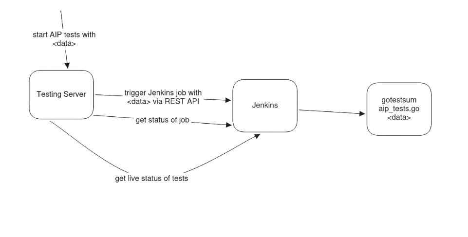

# Jenkins + Go Tests: Proof of Concept

## 1. What we are doing

We want people to start automated tests through an API, and not by running Go tests by hand.

A future **Testing Server** will take a request like `{"instance_url": "https://aip.example.com"}`, ask Jenkins to run the Go tests against that instance, follow the run, and give the results to a UI.

**This repo is only a proof of concept (PoC).** We did not build the Testing Server here. We checked that **Jenkins can do everything the Testing Server will need**.

**Main rule:** Jenkins only runs the tests. It holds no test logic. So we can replace it later (for example with GitHub Actions or GitLab Runner) without rewriting the tests.



## 2. Components

| Component | What it does | Where it is in this repo |
|---|---|---|
| Testing Server | Receives the request, triggers Jenkins, reads status and results. **Not built yet.** In this PoC, `curl.exe` and the live-status tool play its role. | Not in the repo |
| Jenkins | Runs the job in a `golang:1.23` Docker container. Holds no test logic. | `Jenkinsfile` |
| Go tests with gotestsum | The actual tests. They read the server URL from the environment variable `AIP_INSTANCE_URL`. gotestsum writes JSON and JUnit reports. | `aip_test.go`, `aip_input_test.go`, `consent_test.go` |
| Sample target server | A tiny To-Do API (create, read, update, delete) that the tests run against. | `cmd/todo-server` |
| Live-status tool | Reads the Jenkins console log while a build runs, and shows each test as RUNNING, PASS or FAIL. It prints in the terminal, or shows a live web page. | `cmd/live-status` |

## 3. Objectives and results

| # | Objective | Met? | Comments |
|---|---|---|---|
| 1 | A Jenkins job that runs a Go test | Met | Job `go-test-poc` reads the `Jenkinsfile` from Git and runs the tests inside a `golang:1.23` container. |
| 2 | Trigger the job remotely through the REST API | Met | `POST /job/go-test-poc/buildWithParameters` with an API token. No crumb is needed when a token is used. Jenkins answers `201` with a queue ticket in the `Location` header. A missing or empty login gives a confusing `403 No valid crumb`. |
| 3 | Pass an instance URL and read it inside the Go test | Met | Parameter `INSTANCE_URL` becomes the environment variable `AIP_INSTANCE_URL`, and the test reads it with `os.Getenv`. We also tested more fields: separate parameters, one JSON string, and a password parameter. |
| 4 | Run the tests with gotestsum and produce JSON reports | Met | `results.json` and `results.xml` are published with every build. gotestsum is pinned to `v1.12.3`, because newer versions need Go 1.24 and the container has Go 1.23. |
| 5 | Get job status and each test's result through APIs | Met | Status: queued (queue item has no `executable`), running (`building: true`), done (`result` is SUCCESS, FAILURE or ABORTED). Results: `testReport/api/json` or the `results.json` file. Both are available only after the build ends. The Testing Server must remember the queue ticket and build number for each request. |
| 6 | See each test's status while the tests are still running | Met, with limits | Read the console log with `/logText/progressiveText` and parse the `=== RUN` and `--- PASS` lines. It is text, not JSON, so something has to parse it. The first test line shows about 8 seconds after the trigger. Do not add `-v` to the test command, or Go holds back subtest results until the end. |
| 7 | Handle failures | Met | Tested: Jenkins down, target server down, wrong login, stopped build, stuck build (timeout), tool version mismatch, Jenkins starting up, and many runs at once. See section 5 for what we saw. |
| 8 | Keep the runner replaceable | Partly met | The tests only need one environment variable and know nothing about Jenkins. We have not proven it with a second runner. |


## 4. How to run the demo

The commands are for **Windows PowerShell**. Use `curl.exe` and not `curl`. Words in `<angle brackets>` or single capital letters such as `B` are placeholders. Replace them with real values.

### 4.1 Start everything

**1. Start Docker Desktop**, then start Jenkins:

```powershell
docker start jenkins-blueocean
```

**2. Open Jenkins** at `http://localhost:8080` in your browser and log in. Wait about a minute if the page does not load yet.

**3. Create an API token** (once). Click your name at the top right, then **Security**, then **Add new Token**, then **Generate**. Copy the token right away. Jenkins shows it only once. Never put the token in the repo.

**4. Set your login in the terminal.** Use the same PowerShell window for everything below, because these variables disappear in a new window. Your Jenkins user ID is on your profile page.

```powershell
$env:JENKINS_USER = "<your-jenkins-user-id>"
```

```powershell
$env:JENKINS_TOKEN = "<your-token>"
```

```powershell
$auth = "$($env:JENKINS_USER):$($env:JENKINS_TOKEN)"
```

Check that it works. You should see your user ID in `"name"`, and not `anonymous`:

```powershell
curl.exe -s -u $auth "http://localhost:8080/whoAmI/api/json"
```

**5. Start the sample To-Do server** in its own terminal window and leave it running:

```powershell
go run ./cmd/todo-server
```

Check it in the browser at `http://localhost:8081/health`. It should show `{"status":"ok"}`.

### 4.2 One-time setup (already done on the demo machine)

- Jenkins runs in Docker with the Docker socket mounted and with `--user root`. Jenkins needs this to start a Go container for each build.
- Git inside Jenkins must trust the workspace folders. If you recreate the Jenkins container, run this again:

```powershell
docker exec jenkins-blueocean git config --system --add safe.directory '*'
```

- Create the job: click **New Item**, name it `go-test-poc`, choose **Pipeline**, click **OK**. In the **Pipeline** section set **Definition** to *Pipeline script from SCM*, **SCM** to *Git*, **Repository URL** to this repo, **Branch Specifier** to `*/main`, and keep **Script Path** as `Jenkinsfile`. Click **Save**.
- After you change the parameters in the `Jenkinsfile`, run one build first. Jenkins only learns about new parameters after a build has run the new file.

### 4.3 Demo 1: Run it from the Jenkins page

1. Click **go-test-poc**.
2. Click **Build with Parameters**. Keep `INSTANCE_URL` as `http://host.docker.internal:8081` and click **Build**. (`host.docker.internal` means your own computer, as seen from inside the Go container. `localhost` would mean the container itself.)
3. In the **Builds** list on the left, click the new build number at the top.
4. Click **Console Output**. The log fills up live. Look for `Testing against: http://host.docker.internal:8081`, then `=== RUN` and `--- PASS` lines for each test. The build ends with `Finished: SUCCESS`.
5. Go back to the build page. Click **Test Result** to see every test with its status. Under the build's artifacts you will also see `results.json` and `results.xml`.

A normal run takes about 20 seconds. Each test request waits 2 seconds on purpose (`stepDelay` in `aip_test.go`), so the live view is easy to watch. Set it to 0 to remove the delay.

### 4.4 Demo 2: Trigger it from the terminal (the Testing Server's job)

**1. Start a build:**

```powershell
curl.exe -i -X POST -u $auth "http://localhost:8080/job/go-test-poc/buildWithParameters?INSTANCE_URL=http://host.docker.internal:8081"
```

Look for `201 Created` and a line `Location: http://localhost:8080/queue/item/T/`. The number at the end is the **queue ticket**. It is not the build number.

**2. Follow the ticket to the build number.** Replace `T` with your ticket number:

```powershell
curl.exe -s -u $auth "http://localhost:8080/queue/item/T/api/json"
```

If the answer has no `executable` field, the build is still **queued**. When it has `"executable":{"number":B,...}`, then `B` is the **build number**.

**3. Ask for the build status.** Replace `B` with the build number:

```powershell
curl.exe -s -u $auth "http://localhost:8080/job/go-test-poc/B/api/json?tree=number,building,result"
```

`"building":true` means running. When `building` is false, `result` is `SUCCESS`, `FAILURE` or `ABORTED`.

### 4.5 Demo 3: Get the test results from the API

Replace `B` with a finished build number.

```powershell
curl.exe -s -u $auth "http://localhost:8080/job/go-test-poc/B/testReport/api/json"
```

```powershell
curl.exe -s -u $auth "http://localhost:8080/job/go-test-poc/B/artifact/results.json"
```

The first is Jenkins' own report, with pass, fail and skip counts and a list of tests. The second is the file written by gotestsum. It does not depend on Jenkins, so any runner could produce the same file.

### 4.6 Demo 4: Live status of each test

**A. Web page (best for the demo).** In a new PowerShell window, set the three login variables again from step 4.1. Then start the page:

```powershell
go run ./cmd/live-status -serve
```

Open this in your browser:

```
http://127.0.0.1:9000
```

Now start a build. Use **Build with Parameters** in Jenkins, or the command from Demo 2. After about 5 to 8 seconds the page switches to the new build. Rows appear as `RUNNING` and turn `PASS` or `FAIL` about 2 seconds later. The same data is available as JSON at `http://127.0.0.1:9000/api/status`.

**B. Terminal only.** Start a build, wait about 8 seconds, then run:

```powershell
go run ./cmd/live-status
```

To watch a build you already know the number of, add `-build B`.

If you want to see the raw log in Jenkins instead: open the build and click **Console Output**.

### 4.7 Demo 5: Failure cases

**Stop a running build.** This one command starts a build, waits until the tests are running, stops it, and prints the final result. The expected result is `ABORTED`.

```powershell
$before = (curl.exe -s -u $auth "http://localhost:8080/job/go-test-poc/lastBuild/api/json?tree=number" | ConvertFrom-Json).number; curl.exe -s -o NUL -X POST -u $auth "http://localhost:8080/job/go-test-poc/buildWithParameters?INSTANCE_URL=http://host.docker.internal:8081"; do { Start-Sleep 1; $n = (curl.exe -s -u $auth "http://localhost:8080/job/go-test-poc/lastBuild/api/json?tree=number" | ConvertFrom-Json).number } while ($n -le $before); "Build $n started"; Start-Sleep 12; "Stopping build $n"; curl.exe -s -o NUL -X POST -u $auth "http://localhost:8080/job/go-test-poc/$n/stop"; do { Start-Sleep 2; $r = curl.exe -s -u $auth "http://localhost:8080/job/go-test-poc/$n/api/json?tree=number,building,result" | ConvertFrom-Json } while ($r.building); $r | ConvertTo-Json -Compress
```

**Stuck build and timeout.** The test sleeps for 5 minutes, and the `Jenkinsfile` stops any build after 2 minutes.

```powershell
curl.exe -s -o NUL -X POST -u $auth "http://localhost:8080/job/go-test-poc/buildWithParameters?INSTANCE_URL=http://host.docker.internal:8081&SIMULATE_HANG=true"
```

In Jenkins, open the new build. After about 2 minutes it ends with the grey `ABORTED` icon. **Console Output** shows `Timeout has been exceeded`.

**Target server down.** Press Ctrl+C in the To-Do server window, then start a build. The tests fail with `connection refused`, and the build is `FAILURE`. Start the To-Do server again afterwards.

**Jenkins down.**

```powershell
docker stop jenkins-blueocean
```

```powershell
curl.exe -i -X POST -u $auth "http://localhost:8080/job/go-test-poc/buildWithParameters?INSTANCE_URL=http://host.docker.internal:8081"
```

The request fails at once with `curl: (7) Failed to connect`. This is a network error, not an HTTP status. Start Jenkins again and wait about a minute:

```powershell
docker start jenkins-blueocean
```

### 4.8 Demo 6 (optional): More input fields and secrets

Separate parameters, with a secret in the password type:

```powershell
curl.exe -i -X POST -u $auth "http://localhost:8080/job/go-test-poc/buildWithParameters?INSTANCE_URL=http://host.docker.internal:8081&ENVIRONMENT=testing&CLIENT_ID=test-client&CLIENT_SECRET=test-secret-123"
```

In the build's **Console Output**, look for `AIP_CLIENT_SECRET: set (length 15)`. The test never prints the secret itself. In the API, the secret parameter has no value, and in the queue it shows as `****`.

The whole input as one JSON string. First write the JSON to a file, because PowerShell mangles quote marks:

```powershell
'{"instance_url":"http://host.docker.internal:8081","environment":"testing","client_id":"test-client"}' | Set-Content -Encoding ascii "$env:TEMP\input.json"
```

```powershell
curl.exe -i -G -X POST -u $auth --data-urlencode "INPUT_JSON@$env:TEMP\input.json" --data-urlencode "INSTANCE_URL=http://host.docker.internal:8081" "http://localhost:8080/job/go-test-poc/buildWithParameters"
```

**Rule:** a normal text parameter is readable in the Jenkins API. Never put secrets in it. Use a password parameter or the Jenkins credentials store.

### 4.9 If something goes wrong

| Problem | Cause and fix |
|---|---|
| `403 No valid crumb` | `$auth` is empty or wrong, usually in a new window. Set the three login variables again. |
| `JENKINS_USER and JENKINS_TOKEN must be set` | Same cause. The variables only live in the window where you set them. |
| A big HTML page, "Not Found" | You left a placeholder such as `B`, `N` or `T` in the URL. Use the real number. |
| `curl` shows nothing when the URL has `[ ]` | Add the `-g` flag to `curl.exe`. |
| All tests fail with `connection refused` | The sample To-Do server is not running. |
| Live page shows the old build | Wait 5 to 8 seconds. Jenkins waits 5 seconds before it starts a build. |
| Build fails at `go install gotestsum` | The gotestsum version needs a newer Go than the container has. Keep the pin in the `Jenkinsfile`. |

## 5. Limits and notes for the Testing Server

- **Track each request.** Store the queue ticket and the build number for every request. The queue ticket is the only safe link between a request and its build.
- **Live status comes from the console log.** Jenkins has no JSON API for it. The log is text, with hidden `ha:////...` markers that a parser must remove. The `results.json` and `results.xml` files can only be downloaded after the build ends.
- **Jenkins does not push results.** It only answers when asked, so the Testing Server pulls the results after the build ends. Pushing the JSON from a `Jenkinsfile` step is possible, but we did not test it.
- **Do not add `-v`** to the gotestsum command. It delays subtest results until the parent test ends.
- **Parent tests and subtests** are counted separately in Jenkins' test report.
- **Secrets:** use a password parameter or the Jenkins credentials store. Plain parameters, including a JSON string, are readable through the API.
- **Time limits:** a stuck build stops only if a timeout is set. The Testing Server should also have its own time limit, and treat a failed connection to Jenkins as "runner unavailable".
- **A stopped build and a timeout both end as `ABORTED`.** Only the console log tells them apart.
- **Many runs at once work.** We sent 5 different requests together. All were accepted, waited in the queue, and ended `SUCCESS`. They did not disturb each other. This machine has 2 build slots, so most runs wait their turn. Jenkins still counts a waiting build as "building".
- **Identical requests are merged.** Three identical requests sent together all got the same queue ticket, so they became one build. The Testing Server must put a **unique value** in every request, such as a run ID in `ENVIRONMENT`. Then two requests never look the same. Merging happens only while a request is waiting in the queue.
- **Jenkins starting up needs retries.** After a restart, triggers got `500`, then `503`, then `403`, and then `201` after about 12 seconds. A `403` right after a restart does not always mean a wrong login. The Testing Server should retry for about 30 seconds before it reports "bad login". It should also use a request timeout, because one request was held for about 9 seconds during startup. Retrying a trigger after a timeout can start a second build unless the request has a unique run ID. The retry rule is our advice. We tested only what Jenkins answers, not a retry loop.
- **Keep the runner replaceable:** the Testing Server should talk to a small runner interface, with Jenkins as one implementation. The tests need only the environment variables.

## 6. Repo layout

| Path | What it is |
|---|---|
| `Jenkinsfile` | The pipeline: parameters, environment variables, gotestsum, report publishing, timeout |
| `aip_test.go` | Create, read, update, delete tests against the server in `AIP_INSTANCE_URL` |
| `aip_input_test.go` | Experiments: extra input fields, JSON input, simulated hang |
| `consent.go`, `consent_test.go` | A small sample function with a unit test |
| `cmd/todo-server` | The sample target server, port 8081 |
| `cmd/live-status` | The live-status tool: terminal mode and `-serve` web page |
| `docs/architecture.png` | The architecture diagram |
